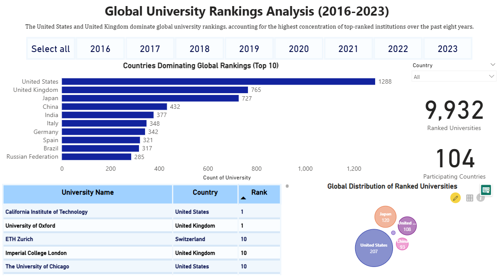
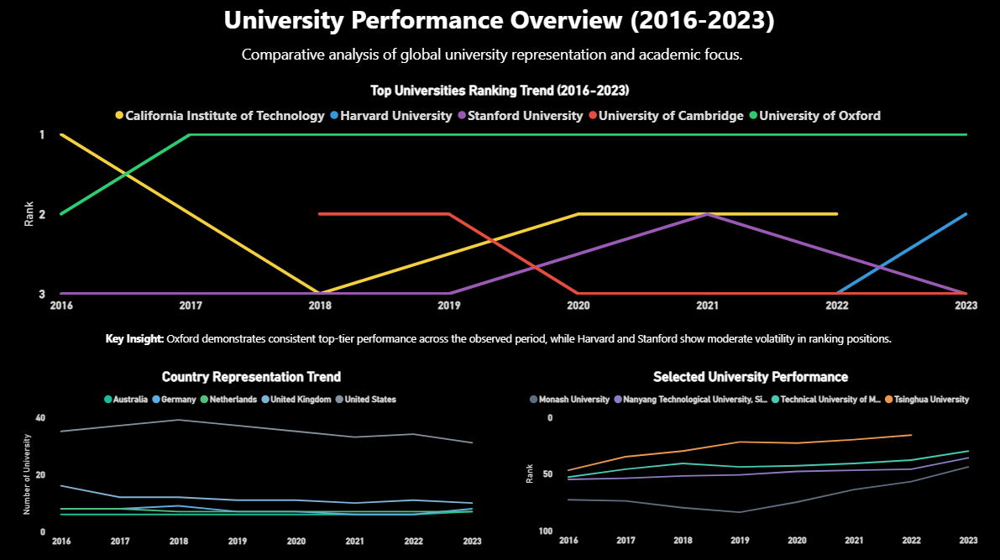
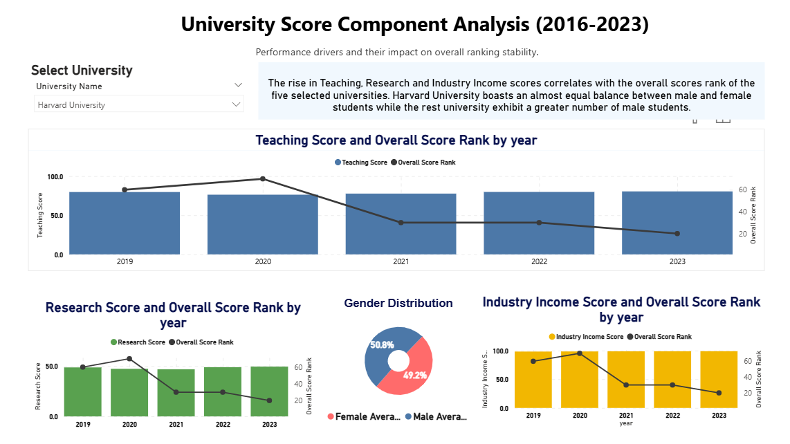

# 🌍 THE World University Rankings – Data Analysis & Dashboard

👩‍💻 Nur Aina Aqiela  
🎓 Bachelor of Science (Hons.) Mathematics | UiTM

---

## 📌 Key Results

✔ Analysed university rankings across 8 years (2016–2023)  
✔ Explored 9,932 ranked universities across 104 participating countries  
✔ Compared ranking trends of selected universities  
✔ Examined teaching, research and industry income performance  
✔ Visualised international student growth from 2.0 million to 3.6 million  

---

## Project Summary

How has global university performance changed over the years?

This project explores the **Times Higher Education (THE) World University Rankings from 2016 to 2023** through an interactive Power BI dashboard.

The dashboard transforms university ranking data into visual insights, allowing users to explore global university representation, ranking movements, performance indicators, gender distribution and internationalisation trends.

The analysis was carried out using Microsoft Excel for data preparation and Microsoft Power BI for interactive visualisation.

---

## 📊 Dashboard Overview

The dashboard consists of four pages, each designed to explore a different dimension of global university performance.

### 1. 🌐 Global University Rankings Analysis

Explore the global distribution and representation of ranked universities.

- Identify the top 10 countries with the highest number of ranked universities.
- Compare university representation across countries.
- View the total number of ranked universities and participating countries.
- Explore individual university names, countries and ranking positions.
- Examine global university distribution through a bubble chart.

### 2. 🏆 University Performance Overview

Discover how selected universities and countries have changed throughout the eight-year period.

- Track ranking movements of leading universities, including Caltech, Harvard, Stanford, Cambridge and Oxford.
- Compare university representation trends across Australia, Germany, the Netherlands, the United Kingdom and the United States.
- Examine ranking changes among selected universities, including Monash University, Nanyang Technological University and others.

**Key observation:** The University of Oxford maintained a leading position from 2017 onwards, while other selected universities experienced changes in their ranking positions.

### 3. 📈 University Score Component Analysis

Explore the relationship between university performance indicators and overall ranking positions.

- Compare teaching scores with overall score rankings from 2016 to 2023.
- Examine research score trends alongside overall score rankings.
- Analyse industry income score changes over the same period.
- Explore gender distribution across selected universities.
- Use the university filter to focus on individual institutions.

The dashboard also highlights differences in gender representation, including Harvard University's relatively balanced male-to-female student distribution compared with the other selected universities.

### 4. ✈️ International Student Growth

Explore the development of international student enrolment and international outlook across the selected years.

- Track international student growth from 2016 to 2023.
- Compare average international outlook scores across years.
- Identify universities with high percentages of international students.
- Filter the analysis by continent to explore regional patterns.

**Key observation:** International student numbers increased from approximately 2.0 million in 2016 to 3.6 million in 2023. The dashboard also highlights Asia's role in international student growth.

---

## 💡 Key Insights

The dashboard highlights several patterns in global higher education:

- **Global university representation:** The United States recorded the highest number of ranked universities (1,288), followed by the United Kingdom (765) and Japan (727).
- **Consistent ranking performance:** The University of Oxford maintained first place from 2017 through 2023 among the universities shown in the ranking trend.
- **University performance indicators:** Teaching, research and industry income scores generally increased across the selected period, providing a basis for comparing changes in university performance.
- **International student growth:** International student numbers increased steadily from 2.0 million in 2016 to 3.6 million in 2023.
- **International outlook:** The average international outlook score fluctuated over the years, reaching its lowest displayed value in 2022 before increasing in 2023.
- **Gender distribution:** The dashboard presents an overall gender distribution and allows users to explore differences in student representation across selected universities.

---

## 🛠️ Technical Skills Demonstrated

- Data collection and preparation
- Data cleaning and organisation
- Data transformation and attribute creation
- Exploratory data analysis
- Excel PivotTables
- Interactive dashboard development
- Data visualisation and insight communication
- Microsoft Excel
- Microsoft Power BI

---

## 🔄 Project Workflow

1. **Data Collection** – Obtained the THE World University Rankings dataset from Kaggle.
2. **Data Preparation** – Selected the relevant ranking years (2016–2023) and organised the dataset using Microsoft Excel.
3. **Data Cleaning** – Reviewed and prepared the data for analysis.
4. **Data Transformation** – Created additional attributes, including year and continent, to support comparisons.
5. **Data Analysis** – Used Excel PivotTables to summarise and examine the dataset.
6. **Dashboard Development** – Created four interactive dashboard pages using Microsoft Power BI.
7. **Insight Presentation** – Presented findings through charts, tables, filters and visual comparisons.

---

## 👩‍💻 My Contribution

**Role: Data Manager**

I was responsible for supporting the data preparation and management process within the group project.

My contributions included:

- Gathering and preparing the THE World University Rankings dataset.
- Cleaning and organising data using Microsoft Excel.
- Creating additional attributes, including year and continent.
- Using PivotTables to summarise and examine the dataset.
- Contributing to dashboard development and the presentation of findings.

This project strengthened my practical experience in preparing datasets, exploring trends and presenting information through interactive data visualisations.

---

## 📂 Dataset

**Source:** [THE World University Rankings 2011–2023 – Kaggle](https://www.kaggle.com/datasets/r1chardson/the-world-university-rankings-2011-2023)

The project focuses on the selected period from **2016 to 2023**.

| Dataset Information | Details |
|---|---|
| Data source | Kaggle |
| Selected period | 2016–2023 |
| Dataset instances | 11,522 |
| Attributes | 24 |
| Dashboard KPI | 9,932 ranked universities |
| Participating countries | 104 |

*Note: Dataset instances and the dashboard's ranked-university KPI represent different measures.*

---

## 🚀 How to Explore the Dashboard

1. Download the Power BI file from this repository.
2. Open `THE World University Ranking Dashboard.pbix` using **Microsoft Power BI Desktop**.
3. Navigate through the four dashboard pages.
4. Use the available filters to explore different years, countries, continents and universities.

---

## 🎓 Project Information

- **Course:** Data Representation and Reporting Techniques (DSC651)
- **Programme:** Bachelor of Science (Hons.) Mathematics
- **Institution:** Universiti Teknologi MARA (UiTM)
- **Project Period:** 2023–2024
- **Project Type:** Group Academic Project
- **Status:** Completed

---

*This was a group academic project. The dashboard and analysis represent the team's work, with my contribution focused on data management and preparation.*
