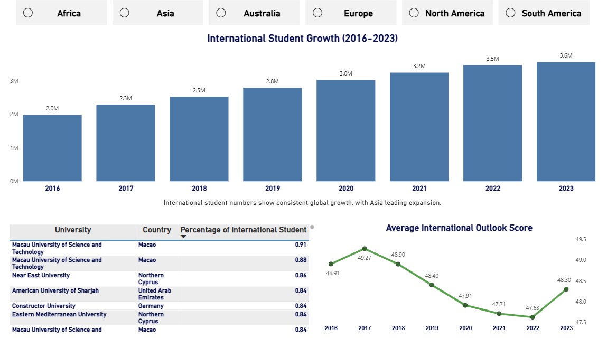

# 🎓 THE World University Rankings – Data Analysis & Interactive Dashboard

Bachelor of Science (Hons.) Mathematics | Universiti Teknologi MARA (UiTM)

---

## 🌍 Can Data Reveal How Universities Compete on the Global Stage?

University rankings offer more than just a list of the world's best institutions. They provide insights into academic performance, internationalisation, institutional strengths and changes in global higher education.

This project explores the **Times Higher Education (THE) World University Rankings dataset** from 2016 to 2023 through an interactive Power BI dashboard.

The goal was to transform raw ranking data into meaningful visual insights and make comparisons across universities, countries and performance indicators easier to explore.

## 📊 Project at a Glance

| Key Metric | Result |
|---|---:|
| Analysis Period | 2016–2023 |
| Ranked Universities | 9,932 |
| Participating Countries | 104 |
| Dashboard Pages | 4 |
| Data Preparation Tool | Microsoft Excel |
| Visualisation Tool | Power BI |

## 🔍 Explore the Dashboard

The dashboard is organised into four pages, each focusing on a different aspect of global higher education.

### 1. 🌐 Global University Rankings Analysis

**Which countries have the strongest representation in global university rankings?**

This page explores the geographical distribution of ranked universities and compares the number of institutions across countries.

Key highlights:
- United States leads with 1,288 ranked universities.
- United Kingdom follows with 765 universities.
- Japan ranks third with 727 universities.
- Interactive year and country filters allow users to explore changes over time.

### 2. 📈 University Performance Overview

**How have leading universities performed over the years?**

This page tracks ranking trends among selected universities and examines changes in country representation from 2016 to 2023.

Key highlights:
- Compares ranking trends for Caltech, Harvard, Stanford, Cambridge and Oxford.
- Explores university representation across selected countries.
- Allows users to examine trends for individual universities.
- Oxford maintained the top position from 2017 to 2023 among the universities displayed.

### 3. 🏛️ University Score Component Analysis

**What factors are reflected in university ranking performance?**

This page examines selected university performance indicators and their relationship with overall ranking positions.

Key highlights:
- Compares Teaching, Research and Industry Income scores over time.
- Explores changes in overall ranking positions.
- Includes a gender distribution analysis.
- Provides a university selector for more focused comparisons.

### 4. 🌏 International Student Growth

**Is internationalisation becoming more prominent in higher education?**

This page explores international student trends and international outlook scores across the selected period.

Key highlights:
- International student numbers increased from approximately 2.0 million in 2016 to 3.6 million in 2023.
- Compares international student growth across continents.
- Examines universities with higher percentages of international students.
- Tracks changes in average International Outlook scores.

---

## 💡 Key Insights Discovered

The dashboard highlights several interesting patterns in global higher education:

| Area | Observation |
|---|---|
| Global representation | The United States had the highest number of ranked universities, followed by the United Kingdom and Japan. |
| University rankings | Oxford ranked first from 2017 to 2023 among the selected universities displayed. |
| University performance | Teaching, Research and Industry Income scores provide different perspectives on institutional performance. |
| Internationalisation | International student numbers showed consistent growth throughout the analysis period. |
| International outlook | Average International Outlook scores fluctuated over the eight years, reaching their lowest displayed value in 2022 before increasing in 2023. |

## 🛠️ Technical Skills Demonstrated

**Data Preparation**
- Data collection and organisation
- Data cleaning and transformation using Microsoft Excel
- Creating additional attributes for analysis
- Data validation and preparation for visualisation

**Data Analysis**
- Exploratory Data Analysis (EDA)
- Comparative and trend analysis
- University and country-level analysis
- Identifying patterns and communicating findings

**Data Visualisation**
- Interactive dashboard development using Power BI
- KPI cards, charts, tables and filters
- Data storytelling and visual presentation

## 🔄 Project Workflow

1. **Data Collection** – Obtained the THE World University Rankings dataset from Kaggle.
2. **Data Preparation** – Cleaned, organised and prepared the dataset using Microsoft Excel.
3. **Data Transformation** – Created additional attributes, including year and continent, to support analysis.
4. **Data Exploration** – Used Excel PivotTables to explore and summarise the data.
5. **Dashboard Development** – Contributed to the development of interactive Power BI dashboards.
6. **Insight Presentation** – Presented findings through visualisations and comparative analysis.

## 👩‍💻 My Contribution

**Role: Data Manager | Group Academic Project**

My main responsibilities focused on data preparation and management, including:

- Collected and prepared the university rankings dataset for analysis.
- Cleaned and organised data using Microsoft Excel.
- Created additional attributes to support year-based and geographical analysis.
- Used PivotTables to summarise and explore the dataset.
- Contributed to dashboard development and the interpretation of findings.

## 📁 Dataset

**Source:** [THE World University Rankings 2011–2023 – Kaggle](https://www.kaggle.com/datasets/r1chardson/the-world-university-rankings-2011-2023)

| Dataset Information | Details |
|---|---|
| Original Dataset | 11,522 instances |
| Attributes | 24 |
| Selected Analysis Period | 2016–2023 |
| Dashboard Coverage | 9,932 ranked universities |
| Geographical Coverage | 104 countries |

*Note: The original dataset contains 11,522 instances. The 9,932 figure represents the ranked-university count displayed in the dashboard.*

## 🚀 How to Explore the Dashboard

1. Download the Power BI `.pbix` file from this repository.
2. Open the file using **Microsoft Power BI Desktop**.
3. Navigate through the four dashboard pages.
4. Interact with the filters and university selectors to explore different comparisons and trends.

## 🎓 Project Information

| | |
|---|---|
| Course | Data Representation and Reporting Techniques (DSC651) |
| Programme | Bachelor of Science (Hons.) Mathematics |
| University | Universiti Teknologi MARA (UiTM) |
| Project Period | 2023–2024 |
| Project Type | Group Academic Project |
| Status | Completed |

---

*This project was completed as a group academic project. My primary contribution focused on data management, preparation and analysis.*
